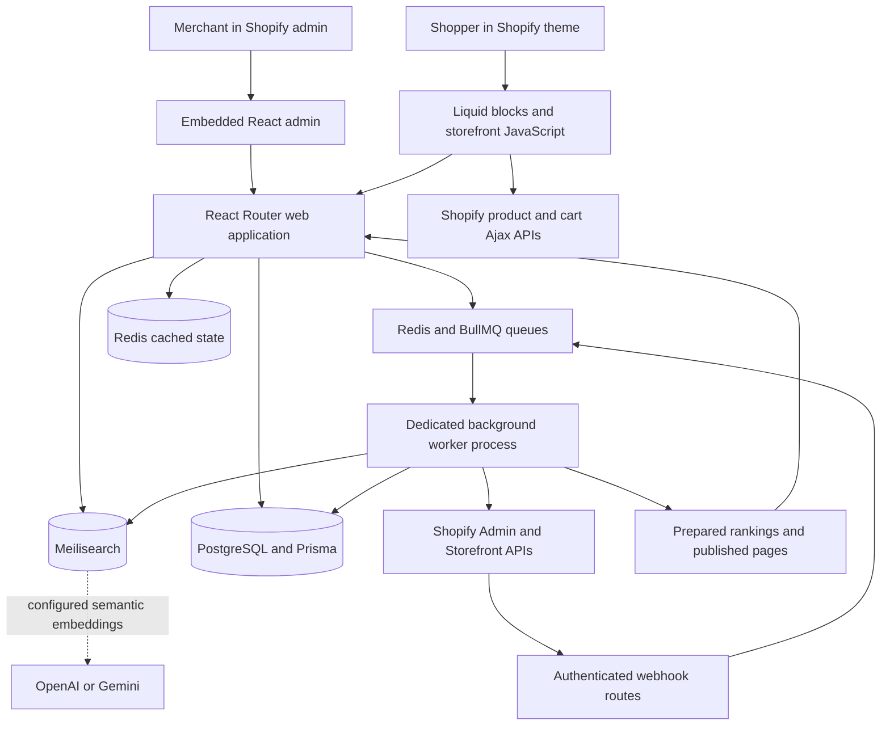

# AI Search and Filter Project Overview

Repository reference and engineering handover, prepared on **21 November 2026**.

This project is an embedded Shopify application named **AI Search & Filter**, with the npm package name `collection-filter-pro`. It provides merchant administration and shopper-facing search, collection filtering, product ranking, merchandising, pinning, market-aware product presentation, and related background processing. Its configured application origin is `https://aisearchfilter.webvory.com`.

The application started from Shopify's React Router template, but its current behavior depends on substantial custom services, a PostgreSQL catalog, Meilisearch indexes, Redis caches and queues, dedicated workers, and a Shopify theme extension. The template sections in `README.md` and `CHANGELOG.md` are not a complete description of this application.

This overview describes the checked-out source and links to detailed design and evidence files. The local Git revision observed while preparing it was `ea58118` (`Audit Finding`). Historical deployment and validation statements below retain their original dates; they do not establish the current state of a remote server or store. Credentials and private environment values are intentionally excluded.

## Contents

1. [Purpose and system boundaries](#purpose-and-system-boundaries)
2. [Architecture and technology](#architecture-and-technology)
3. [Repository layout](#repository-layout)
4. [Merchant administration](#merchant-administration)
5. [Shopper features](#shopper-features)
6. [Search and filtering](#search-and-filtering)
7. [Collection ranking and loading](#collection-ranking-and-loading)
8. [Merchandising and product pinning](#merchandising-and-product-pinning)
9. [Catalog synchronization and integrity](#catalog-synchronization-and-integrity)
10. [Markets and pricing](#markets-and-pricing)
11. [Analytics](#analytics)
12. [Database model reference](#database-model-reference)
13. [Routes and service reference](#routes-and-service-reference)
14. [Theme extension and generated assets](#theme-extension-and-generated-assets)
15. [Configuration and environments](#configuration-and-environments)
16. [Development and commands](#development-and-commands)
17. [Testing and verification](#testing-and-verification)
18. [Deployment and operations](#deployment-and-operations)
19. [Recorded status and unresolved work](#recorded-status-and-unresolved-work)
20. [Operating constraints](#operating-constraints)
21. [Documentation and investigation guide](#documentation-and-investigation-guide)
22. [Glossary](#glossary)

## Purpose and system boundaries

The merchant uses the embedded admin to configure product discovery. Shoppers use JavaScript and Liquid installed through the theme extension. The backend turns Shopify catalog information and merchant rules into indexed search results, filtered collection pages, product cards, facets, and durable prepared pages.

The main surfaces are:

| Surface | Responsibility |
| --- | --- |
| Embedded Shopify admin | Dashboard, filters, search settings, merchandising, pinning, analytics, customization, integrations, and country setup. |
| Full search results | Query results with filters, sort, pagination, selected-state restoration, and applicable search rules. |
| Instant search | Fullscreen or compact search, product and collection suggestions, recent/manual suggestions, and configured empty-search content. |
| Collection pages | Collection membership, rules, pins, filtering, ordering, saved cards, and progressive loading. |
| Product Quick View | Product/variant selection and Shopify Ajax cart interaction, using app UI or a compatible theme adapter. |
| Background processing | Catalog and index writes, webhook processing, ranking preparation, country data, membership checks, and maintenance. |

Shopify remains the authority for the underlying catalog, publication, product detail and cart behavior. PostgreSQL stores application records and catalog copies. Meilisearch provides searchable projections. Redis coordinates cached state, revisions, queues, and some prepared data. The systems are coordinated, but database and index updates are not a distributed transaction.

The application contains compatibility work based on observed SoBooster behavior and imported CSV formats. That work is specific to supported formats and observed ranking patterns; it does not establish complete SoBooster feature, data, or ranking parity.

## Architecture and technology



### Main technologies

Versions below are declared ranges in `package.json`, rather than a fresh audit of installed or deployed versions.

| Area | Technology |
| --- | --- |
| Runtime | Node.js; declared engine `>=20.19 <22 || >=22.12`; production Docker base is Node 20 Alpine. |
| Application framework | React Router 7.12, filesystem routes, server loaders/actions, Vite 6.3. |
| UI | React 18.3, Shopify App Bridge, Shopify custom UI elements, custom reusable components. |
| Persistence | PostgreSQL with Prisma 6.16. |
| Search | Meilisearch JavaScript client 0.58 and custom index/ranking services. |
| Queue and cache | BullMQ 6 and ioredis 5.11. |
| Semantic providers | OpenAI SDK 6.45, Google Generative AI SDK 0.24, provider-aware embedding configuration. |
| CSV processing | Papa Parse 5.5. |
| Drag and drop | dnd-kit core, sortable, and utilities. |
| Asset generation | esbuild 0.25 and a repository build script. |
| Tests | Node's test runner plus custom database, Redis, browser, memory, and bundled-startup fixtures. |
| Deployment | GitHub Actions, Docker, Amazon ECR, EC2, and separate Shopify app/extension publication. |

### Web and worker separation

`CFP_WORKER_MODE=web` and `CFP_WORKER_MODE=worker` distinguish HTTP serving from background processing. `scripts/run-background-worker.mjs` loads the built server module graph without starting an HTTP listener and waits for eight worker instances plus required scheduler functions.

The readiness file is `/tmp/cfp-background-worker.ready`. Readiness requires the processors to connect successfully, rather than merely starting a Node process. Shutdown removes the file, cancels owned maintenance timers, and closes workers.

The web process runs through `scripts/serve-with-health-watchdog.mjs`. Its supervisor checks `/healthz` and terminates an unresponsive child so container restart policy can recover it. `/healthz` deliberately checks HTTP responsiveness independently of authentication, PostgreSQL, Redis, or search availability. A successful response alone does not prove that the application dependencies are healthy.

## Repository layout

| Path | Contents and role |
| --- | --- |
| `app/routes/` | Embedded admin screens, public APIs, internal APIs, authentication, webhooks, health, and privacy routes. |
| `app/components/` | Shared admin UI, search configuration, merchandising import/export, analytics, modal, and status components. |
| `app/services/` | Server orchestration for search, sync, markets, ranking, caching, reports, queues, and Shopify integration. |
| `app/utils/` | Shared normalization, validation, pricing, filtering, ranking, snapshot, and browser-compatible helpers. |
| `app/workers/` | Product sync worker and webhook/background processor registration. |
| `app/config/collection-prewarm.json` | Configured background collection preparation context. |
| `app/graphql/queries.js` | Shared GraphQL query definitions. |
| `app/hooks/` | Navigation, product picker request coordination, and completed-submission feedback hooks. |
| `app/shopify.server.js` | Shopify application setup, authentication exports, sessions, and post-authentication hook. |
| `app/db.server.js` | Prisma client setup. |
| `app/root.jsx`, `app/entry.*.jsx` | Root document and client/server entry points. |
| `app/routes.js` | React Router filesystem route discovery through `flatRoutes()`. |
| `extensions/theme-extension/` | Storefront Liquid blocks/snippets, CSS, JavaScript, generated bundles, and extension configuration. |
| `prisma/schema.prisma` | Application database models, relations, and indexes. |
| `prisma/migrations/` | Historical schema changes; 23 migration directories were present when this overview was prepared. |
| `scripts/` | Asset build, worker launch, audits, repair tools, relevance tools, sync operations, and regression runner. |
| `tests/` | Unit, regression, database, browser, Redis, theme, memory, and startup checks. |
| `docs/` | Detailed implementation notes, behavior contracts, rollout guidance, audit history, and UK configuration review. |
| `theme-fixes/uk/` | Staged replacement for a separate UK theme asset; not automatically installed by the app extension. |
| `public/samples/` | Public sample files used by the app. |
| `data/relevance/` | Search relevance datasets and associated documentation. |
| `scratch/` | Local evidence, diagnostic outputs, snapshots, fixture builds, and logs; not a production source of truth. |
| `dumps/` | Local dump artifacts; avoid treating captured data as current production state. |
| `.github/workflows/` | Main deployment and targeted operational workflows. |
| `.env` | Local environment configuration; values must not be copied into project documentation. |
| `.codex/`, `.claude/`, `.cursor/`, `.gemini/` | Local agent/editor configuration; preserve unrelated existing content. |
| `AGENTS.md` | Current operating constraints and extensive dated handover history. |
| `README.md` | Feature notes mixed with original template setup instructions. |
| `CHANGELOG.md` | Primarily upstream Shopify template history. |

## Merchant administration

The embedded shell in `app/routes/app.jsx` authenticates the admin session, ensures a default filter group, and exposes Dashboard, Filters, Search, Analytics, Collections, and Settings navigation. An upgrade route exists, but the shell's upgrade navigation entry is commented out; its presence is not proof of an active billing product.

### Dashboard

The dashboard summarizes database product rows, Shopify product scope, full-sync progress, errors, queue/worker signals, and related status. `SyncStatusSummary.jsx` and `syncDashboard.js` distinguish queued, scanning, finalizing, stopped, completed, unavailable-queue, and missing-worker conditions.

Important status semantics:

- A full scan counts every processed Shopify product, including draft, archived, and unpublished records.
- Stored storefront catalog eligibility is active plus Online Store publication.
- Reaching the end of scanning does not establish successful finalization.
- The latest attempt's completion is separate from an older successful full-sync timestamp.
- Database rows and Shopify active/published counts have different meanings and are displayed separately.
- Incremental freshness and source/index ID reconciliation remain unverified without the required evidence.

See [Product sync status](docs/product-sync-status.md).

### Filters

The admin supports filter groups and their items, collection/search assignments, enabled/default states, saved filter views, global display settings, merged values, and numeric size mappings. Item configuration is stored as JSON to support type-specific behavior such as display mode and manual values.

Disabled assigned groups are ignored at runtime; the enabled default group supplies fallback behavior. An assignment alone does not enable a group. Existing disabled groups and assignments must not be changed merely to make a comparison look complete.

### Search configuration

Merchant controls include instant-search layout, product and suggestion limits, search page size, visible card information, URL updates, searchable/suggestible fields, field weights, text transforms, selected metafields, delimiters, stopwords, SKU matching, empty-search products, and compact-layout collection content.

The app also provides synonyms, redirects, suggestion blacklist rules, search banners, search merchandising, and search pinning. Custom field changes can require prepared source data or a separate index setup. The save service rejects unsupported unprepared changes while retaining existing rules; it does not silently start a full Shopify sync to satisfy them.

### Collections

Collection screens provide merchandising rules, product pin lists, collection/product pickers, rule previews, filters, list ordering, CSV import/export, and detailed import results. Collection identity is based on Shopify IDs where available; names remain display labels and are insufficient to distinguish duplicate titles.

### General settings and integrations

Settings govern existing product/filter presentation controls, stock behavior, sort-versus-pin/rule preferences, Quick View, wholesale behavior, customization, theme setup, and country availability.

The Integrations page currently configures **Wishlist Growth** only. Its enabled flag does not prove installation or health. Ratings, translation, and currency adapters are not available through that page. Wishlist functionality is outside the current authorized testing scope.

### Accessibility and action handling

`app/components/ui/RuleControls.jsx` supplies native named action buttons, real edit links with SPA modifier handling, stable switch labels and checked state, pending-state disabling, visible focus, and dialog semantics.

The shared delete dialogs provide an accessible name, initial Cancel focus, Tab containment, Escape dismissal, and focus restoration. These controls are applied to the four search/collection pinning and merchandising list routes. Row and header checkboxes have separate descriptive names. This is a scoped implementation and test result, not an accessibility certification of every admin screen.

## Shopper features

### Instant search

Fullscreen and compact layouts expose configured suggestions and product discovery before or after typing. Search settings control minimum query length, product/suggestion counts, popular or explicitly selected products, recent queries, collection entries, and display settings.

Source defaults include six instant-search products, six suggestions, five collection suggestions, four recent searches, two characters before search, and four default fullscreen products. Merchant settings can override them. Fullscreen is the default layout; compact configuration is retained separately.

### Full search and browser history

The results grid supports selected facets, sort, pagination, and URL state. Search URL handling serializes current selections, hydrates state on initial load, and processes Back/Forward transitions without retaining absent stale facets. Query changes must update the request query as well as the visible URL.

Unknown parameters, supplied preview parameters, and URL hashes are preserved through application transitions. Shopify can strip bare preview IDs before app JavaScript runs; serializer support does not prove that a particular draft theme loaded.

### Product cards and images

Cards coordinate product links, images, matching variants, prices, SKU presentation, sale/sold-out information, hover imagery, and Quick View settings. Shared selection rules matter: a matching color image, available size, and displayed market price must describe the same eligible variant where required.

Product rendering uses prepared cards or batched hydration rather than a new Shopify request for every displayed card. Exact behavior depends on request context and the applicable preparation path.

### Quick View

The shared implementation serves collection and instant-search entry points. It fetches fresh locale-aware Shopify Ajax product data, handles variant combinations and availability, prevents repeated cart submission, reports failed requests, and manages keyboard/modal lifecycle.

Two preferences exist: App default and Theme Quick View when available. Runtime capability detection chooses a compatible adapter and falls back to the app. The implementation notes describe Dawn Quick Add and a Prestige integration; these are bounded compatibility implementations, not universal support for all theme versions.

Size charts require compatible existing theme content. Chart extraction imports a constrained node after removing scripts and inline handlers, and cancels stale variant work. There is no general merchant chart-page selector or automatically supplied default size chart. Cart timeouts require careful messaging because a write can have reached Shopify before the response was lost.

See [Quick View implementation](docs/quick-view-implementation.md).

### Search promotions and theme customization

Search banners match normalized exact queries and can appear at the top or at a configured product-grid position. They do not replace products or alter ranking, facets, result totals, or pagination. Top banners require an image; grid banners can contain text. Images are uploaded separately through Shopify and referenced by URL.

Theme customization saves CSS, optional JavaScript, and visual filter swatches per shop/theme. Saving does not write Shopify theme files. JavaScript is opt-in, syntax-checked server-side without execution, and runs once after DOM readiness. Documented events include `cfp:customization-ready` and `cfp:search-products-rendered`.

`cfp_disable_customization=1` provides a preview recovery path. New themes have no customization. Custom code is not a sandbox and is not interchangeable with SoBooster's template SDK. The feature does not include revision history, a visual canvas, or an independent draft/publish system.

## Search and filtering

### Search request flow

1. Read shop, query, surface, country/currency, customer context, and saved configuration.
2. Resolve query intent, possible SKU/product-code lookup, configured color interpretation, and applicable rules/pins.
3. Select the appropriate shared or shop-specific search index context.
4. Retrieve lexical or hybrid candidates with shop and product eligibility constraints.
5. Apply supported intent, merchandising, stock, variant, market, and facet predicates.
6. Rank, paginate, hydrate visible records, and return products with settings/facets as required by the surface.

`api.search.jsx` principally serves instant search. `api.filter.jsx` coordinates full-search and collection filtering and contains several optimized collection response paths. `api.facet.jsx` serves remote facet-value searches. Their response contracts differ; route names should not be assumed to make them interchangeable.

### Keyword and semantic behavior

OpenAI is the default semantic embedding provider. `text-embedding-3-small` is configured for 768 dimensions and a 0.5 semantic ratio. Gemini remains supported through separate provider configuration. Provider-specific embedder names prevent vector reuse across providers.

Semantic failure can retry through keyword search. Product-code queries deliberately use exact-oriented matching rather than broad semantic behavior. Embedding setup is explicit; normal catalog sync does not automatically provision embeddings unless the corresponding setup flag is enabled.

The optional authenticated embedding relay batches and caches provider requests. Switching providers requires deliberate setup/regeneration; changing only the provider setting does not make existing vectors compatible.

`ai.server.js` also contains a separate optional Gemini natural-language extraction helper. Its existence is distinct from the provider-aware semantic ranking path; a comment mentioning OpenAI in that helper should not override the actual implementation.

### Search field configuration

Default field definitions cover title, handle, product type, vendor, tags, collections, SKU, barcode, description, product options, and product metafields. Description and barcode are not enabled for search by default. Field definitions distinguish search from suggestion use and carry weights and transforms.

Supported transforms include trimming, case conversion, HTML stripping, prefix/suffix removal, and replacement. Additional product/variant metafields require valid namespace/key selection and prepared source data. Wildcard variant-metafield selection is rejected by validation.

### Facet and manual-value correctness

Facet comparison normalizes case and surrounding whitespace while preserving raw tokens. Case-only variants such as `Teal` and `TEAL` become one displayed choice. Meaningfully different values such as `Dark Teal` or `Off White` remain separate. Merchant merge targets take precedence where configured.

Counts are distinct-product unions; raw token counts cannot simply be added when one product has multiple equivalent values. Remote facet search must use the same grouping contract as the main response.

Manual values are canonically string arrays. Compatible legacy CSV and JSON-array strings can be read, while malformed objects, numbers, and mixed arrays are rejected at save/import boundaries. Invalid saved lists must not silently become an unrestricted filter. Remote search results cannot mutate the configured allow-list or its order.

Synonyms and facet merges serve different purposes: synonyms affect query interpretation/search; merges group filter values. The current synonym editor creates both directions and cannot safely express a one-way mapping without additional work.

### Membership and sorting invariants

Restrictive search facets must narrow the baseline query candidates. Selecting a size or color must not introduce unrelated products outside the original search set. Changing sort must order the same eligible membership rather than changing the candidate universe.

Filtered sort paths share variant eligibility context. Price, color, size, country, stock, and currency must agree on the eligible variant. Saved market price projections used for sorting do not overwrite the base price inputs used by Price Exclude rules.

`priceBounds.js` supplies shared decimal half-up behavior for server and generated browser helpers. List bounds agree with displayed whole-unit labels; numeric inputs preserve currency minor-unit precision. The prior broad half-unit tolerance is removed. Explicit selected maximums remain independent of changing facet maxima.

Important source references: `availableVariants.js`, `facetNormalization.js`, `manualFacetValues.js`, `filterPresentation.js`, `priceBounds.js`, `searchRanking.server.js`, `queryParser.server.js`, and `searchIndex.server.js`.

## Collection ranking and loading

Collection loading has several coordinated fast paths and fallbacks. A first page can depend on collection membership, Shopify order, merchant rules, pins, variant facts, country proof, and prepared cards. A single cache hit or healthy queue does not establish that all those dependencies are ready.

### Ranking inputs and identity

Prepared rankings include normalized request context and versioned dependencies. Shop, collection identity, country/market, filters, sort, customer context, rules, pin data, and data revisions can affect reuse. A result for an anonymous unfiltered country request cannot be freely reused for a different filtered/customer/market request.

The ranker scans compact candidates and uses shared comparators. Tag-only paths and variant-dependent paths use bounded batches. Only visible pages subsequently need complete product-card hydration where no saved card copy is available.

`collectionRuleFacts.server.js` maintains versioned facts matching source/index inputs. Missing facts, unsupported conditions, races, or unavailable infrastructure can fall back to queued preparation. Current code enables collection facts for a nonempty shop unless `CFP_COLLECTION_DIRECT_RANKING=false`; the older direct-ranking document describes a narrower shop allowlist that is no longer the current gate.

### Shopify order and frozen pagination

Native best-selling collection order comes from a complete Shopify order snapshot. A separate collection-order queue prevents these reads from waiting behind catalog webhook work. A first visit without a valid snapshot waits for correct order rather than substituting an unrelated sequence.

Ranking sessions preserve a frozen sequence for pagination. New configuration or data can generate a replacement for new sessions while existing tokens maintain their supported contract. Tokens and proof identity prevent page mixing across incompatible contexts.

### Durable and published pages

`CollectionLoadingSnapshot` stores bounded disposable copies in PostgreSQL so Redis eviction need not force all unchanged work to restart. Different snapshot kinds and generations serve distinct reuse contracts.

Anonymous native best-selling requests can negotiate `application/x-cfp-published-page-v1`. Background publication materializes the first 50 complete cards, facets/settings, and the full canonical ID sequence. Normal shopper pages contain 25 cards. The first two pages can use the immutable published version, while later pages retain the ranking token and use normal hydration.

Publication atomically replaces complete verified versions and rejects delayed older builds. A published page can intentionally retain old product details, rule effects, or order until replacement. Registered visits can queue deduplicated refresh work when the publication is old. The documented daily freshness target depends on workers and is not a guarantee.

### Progressive browser startup

Liquid head snippets begin supported collection work earlier. The main widget consumes a prefetched response only when the full normalized URL matches, including shop, collection, country, customer, filter, sort, and page context. Changed or mismatched requests are aborted and use the normal path.

The browser coordinates loading skeletons, proven-pin previews, stream readers, filter readiness, card rendering, and optional price/image follow-up. Search pages use their separate startup contract and do not consume collection prefetches.

Pending preparation is a real state. Depending on the request/protocol, the client receives pending information or retries. Country-unprepared requests return HTTP 202; obsolete country paging proofs can produce HTTP 409 and require restarting page one. Pending must not appear as a successful empty collection.

### Performance boundaries

The intended experience is early useful cards and responsive filtering. Local memory/browser fixtures demonstrate particular implementation properties, not a universal live two-second response guarantee. Cold collections, new country/filter contexts, Shopify throttling, missing facts, rebuilds, worker outages, and large variant sets remain relevant to latency.

See [Collection first visits](docs/collection-first-visit-preparation.md), [Direct ranking](docs/collection-direct-ranking.md), and [Order queue](docs/collection-order-queue.md). Older numeric test totals, worker counts, and rollout defaults in these documents describe their publication dates.

## Merchandising and product pinning

### Rule dimensions

Merchandising rules store shop ownership, rule type, name, optional numeric ordinal, collection titles/IDs, search queries, country/locale/customer targeting, schedule, status, and conditions. Condition records carry action, field, operator, operands, numeric bounds, and date values as appropriate.

Runtime behavior includes supported Include, Exclude, Pin, Set/Dynamic scoring, Boost/Bury, and variant-based matching. The shared matcher/comparator controls actual support and precedence. Global settings can prioritize shopper sorting over pinning or merchandising.

### Collection identity and compatibility

ID-bound rules distinguish collections with identical titles. Legacy title-bound data retains its existing compatibility path; new ambiguous title-only bindings must not be guessed.

Supported ordinal Set patterns execute in their saved order: a later matching Set can replace an earlier score. A narrowly recognized tag-score ladder refines merchandising Pin precedence without overriding stronger scores or admitting unscored products ahead of the supported ladder. Arbitrary arithmetic and unsupported rule patterns keep their existing comparator behavior.

Observed ordering compatibility is not a recovered specification of a vendor's private backend. Tied scores, extra/missing products, competing pin lists, and complete membership parity require separate evidence.

### Explicit pins and eligibility

Pin rules retain selected product order and search/collection scope. Imported collection pin lists with Include rules position already eligible members or matching Include products; they do not automatically grant membership. Collections without Include rules retain the documented explicit outside-member pin behavior. Search pins must also satisfy applicable search intent and filters.

Country eligibility and relevant exclusions must apply to pins. A high-priority placement is not permission to show an unavailable or otherwise filtered-out product.

### Search pin editor

Targeted create/edit uses one search-term field. Replacing that term preserves the rule's product order and refreshes the picker. Empty/malformed/multiple-term edits are rejected. Legacy multi-term rules are displayed without automatic migration and require an explicit single-term selection before saving. All-search rules remain supported.

### CSV import and export

Merchandising and pinning import dialogs show imported/skipped counts and per-record reasons. Valid records can proceed while invalid records are reported. A replacing merchandising edit uses a transaction so failed replacement preserves the prior rule/conditions.

Merchandising imports preserve numeric Ordinal, including negative and fractional values. Admin lists show lowest ordinal first, followed by rules without one using their date fallback. This admin list order does not, by itself, establish storefront precedence.

Pin imports preserve source CSV order across parallel batches through `importOrder`. Search pinning defaults to search-term A–Z; collection pinning has its documented collection-ID text order; CSV/date alternatives remain available. Product order within each rule is separate from list display order.

An unreadable or incomplete batch response makes affected records **unconfirmed** because writes may already have occurred. Existing rules must be checked before retrying. Third-party exports still require supported formats; the importer is not a universal vendor conversion tool.

See [Single-term search pinning](docs/search-pinning-single-term.md), [Collection pin list order](docs/collection-pin-list-order.md), [Sequence compatibility](docs/collection-sequence-compatibility.md), and [Pin precedence](docs/collection-merchandising-pin-precedence.md).

## Catalog synchronization and integrity

### Full and incremental sync

The product-sync queue provides durable full-sync work. Shopify product/inventory webhooks queue incremental processing. `sync.server.js` transforms canonical products, variants, memberships, metafields, images, market prices, and derived filter/search fields into PostgreSQL records and Meilisearch documents.

Product index records include shop ownership, normalized IDs, availability, collection membership, image/option data, variant price information, ranking metrics, and other derived fields. Selected internal metafields are deliberately excluded from public projections.

The sync contract verifies intended membership writes after successful index acknowledgement before advancing the checkpoint. Failed verification keeps the cursor unadvanced for retry. Source pagination must be complete; a partial response cannot be treated as a complete product or membership set.

Search index updates use their own bounded queue, preventing collection recovery work from delaying merchant search configuration. Shopify bulk catalog/index services support large-catalog discovery and indexing paths.

### Webhooks

The app configuration subscribes to paid/cancelled orders, product create/update/delete, inventory changes, collection create/update/delete, uninstall, scope updates, and Shopify customer/shop compliance topics.

Webhook routes authenticate incoming Shopify traffic and delegate supported work to the corresponding services/queues. Product and inventory events can invalidate or refresh stock proofs, market preparation, catalog data, and derived collection inputs. Order processing updates sales-derived ranking metrics.

### Queue lanes

| Queue | Main responsibility |
| --- | --- |
| `productSyncQueue` | Full product synchronization and checkpointed catalog work. |
| `webhookQueue` | Product/inventory/order/collection webhook jobs and supported event work. |
| `collectionRankingQueueV2` | Prepared collection ranking, cards, and related background tasks. |
| `searchIndexQueueV1` | Search index setup/update jobs and product deltas. |
| `synonymActivationQueueV1` | Asynchronous synonym activation and migration/reconciliation work. |
| `collectionOrderQueueV1` | Complete Shopify collection order snapshots. |
| `collectionMembershipQueueV1` | Scheduled membership integrity audits. |
| `marketAvailabilityQueueV1` | Country availability discovery, full scans, and deltas. |

Retry/backoff/retention settings differ by queue. Their separation prevents one class of backlog from occupying every other worker lane; it does not remove Shopify or infrastructure limits.

### Scheduled maintenance

The dedicated runner schedules public collection warmups and membership checks on minute timers, catalog drift and unclassified size-mapping work on an hourly timer, synonym reconciliation on a minute timer, and analytics expiration daily. Services can impose additional due-time checks, locks, and intervals. A timer firing is not proof that all catalog contexts were refreshed.

Membership audits paginate canonical published collection data, compare database/index sets, and strict-sync only differences. They defer during a full product sync and retain cursor/status information. Interrupted or invalid audits must not advance the cursor or claim success.

### Read-only product reconciliation

`scripts/reconcile-product-ids.mjs` is an offline file comparator. It requires complete Shopify/database/index ID arrays with matching shop, publication, status, and market scope. It normalizes GIDs and numeric IDs, deduplicates, and reports missing and extra IDs.

The database and index inputs must retain stale extras; pre-intersecting them with Shopify would hide the defect being investigated. Matching counts do not prove matching IDs. Capture times remain relevant because legitimate catalog edits can occur between snapshots.

The comparator makes no service connection, performs no repair, and starts no sync. Production ID reconciliation and an acknowledged incremental/index freshness watermark were still unverified in the latest recorded dashboard work.

### Repair tools

The repository contains collection-identity, product-membership, verified-link, snapshot compaction, and superseded-job tools. Their scopes and apply modes differ. A captured plan or dry-run report does not authorize execution. Relevant references are [Membership integrity](docs/collection-membership-integrity.md) and [Product membership repair](docs/product-membership-repair.md).

## Markets and pricing

### Separate concepts

| Concept | Meaning |
| --- | --- |
| Country eligibility | Whether Shopify considers a product sellable in a specific country context. |
| Variant availability | Whether the relevant variant can be purchased under the applied stock rules. |
| Market price | Contextual price/compare-at information for a country/currency. |
| Display currency | Currency formatting/presentation; changing it alone does not establish country eligibility. |
| Prepared coverage | Whether the required country snapshot/cards/prices are ready for a particular surface and request. |

### Price preparation and presentation

`MarketPriceConfiguration` records enabled pricing countries/currencies. Variant market prices are stored separately from base prices, and index projections support contextual filtering/sorting. Installation and coverage services coordinate background preparation.

Cards may perform separate market-price verification after initial rendering. Selected price bands must be tested against the matching available color/size variant, not a cheaper unrelated variant. Missing-price policy and rounding must agree across SQL and fallback paths.

Post-authentication setup enqueues market-price installation work. Authentication or starting a server against a live environment is therefore not necessarily a passive read-only activity.

### Country availability connection

The supported setup uses optional `unauthenticated_read_product_listings` permission and a server-held Storefront token. Connection verifies permission/token access and schedules country discovery/preparation. Tokens are stored separately from public filter settings.

Country snapshots derive product-level `availableForSale` from explicit Storefront `@inContext(country: ...)` queries. Country eligibility applies independently of the global in-stock switch. Per-country locks, epochs, and proof identity prevent racing or partial scans from becoming current snapshots.

Discovered countries can be refreshed in the background. Unchanged proofs avoid unnecessary rebuilds; changed eligibility schedules corresponding country preparation. Webhooks and publication remain eventual, so this is not instantaneous stock parity.

The UK review did not connect or activate this feature. A supported code path and passing local fixtures do not prove that a particular store has granted permission or that collection, full search, instant search, Quick View, and pagination all have verified country coverage.

See [Country availability](docs/country-availability.md) and [UK review](docs/reviews/uk-store-configuration-review.md).

## Analytics

`searchAnalytics.js` instruments storefront events, `/api/v2/events` accepts validated batches, and report services power `/app/analytics`.

The event model accommodates query/filter/product interaction, cart-related records, and experiment exposure identifiers. Ingestion uses an explicit field allow-list, validates shop and installation, limits body size to 64 KiB, limits batches to 25 events, validates timestamps/identifiers, rate-limits requests, and deduplicates by event ID.

Stored fields include anonymous/session/search/listing identifiers, market/locale, query or filter information, hits, product/variant/position, rule identifiers, and optional experiment context. Unknown arbitrary event properties, cookies, IPs, and customer identifiers are not accepted through the normalizer.

Retention is 13 calendar months. Daily maintenance deletes in bounded batches rather than one unbounded transaction. Reports reflect captured application events; they are not automatic proof of complete Shopify orders, revenue attribution, or delivery of every browser event.

## Database model reference

`prisma/schema.prisma` uses PostgreSQL. Prices use decimal fields, flexible settings/projections use JSON, and selected arrays/text fields have GIN/trigram indexes. Existing deployments need the appropriate PostgreSQL extensions, including `pg_trgm` for trigram operator classes.

| Model | Main data and relationships |
| --- | --- |
| `Session` | Shopify online/offline sessions, access/refresh tokens, scopes, user metadata, and expiry. |
| `Product` | Shop-owned product copy, title/handle/vendor/type, min/max price, tags, images/options, status, timestamps, and sales metrics. Parent of variants, metafields, and memberships. |
| `Variant` | Product child with price/compare-at, availability/inventory, options, image, SKU, market prices, and size mapping evidence. |
| `Collection` | Shop-owned Shopify collection ID/title/handle. |
| `ProductCollection` | Product-to-collection join, composite product/collection primary key. |
| `ProductMetafield` | Product namespace/key/value/type with uniqueness per product and key. |
| `SizeNumericMapping` | Per-shop mapping of source size values to numeric US size. |
| `FilterSetting` | Shop/type/key filter definition, display type, label, enabled state, and ordering. |
| `FilterGroup` | Named shop-owned group, default/enabled state, order, items, assignments, and saved views. |
| `FilterGroupCollection` | Group assignment to collection/search context, with collection ID/title and page type. |
| `FilterGroupItem` | Group filter type/key, label, display mode, enabled/order state, and JSON configuration. |
| `SavedFilterView` | Named conditions and match type attached to a filter group. |
| `MergedValue` | Shop/type/key target label, raw source values, active state, and timestamps. |
| `MerchandisingRule` | Targeting, schedules, enabled state, rule type, collection IDs/titles, queries, and optional ordinal. |
| `MerchandisingRuleCondition` | Action/field/operator/operand/bounds/date attached to a merchandising rule. |
| `PinnedProductRule` | Product JSON/order, name, status, all/targeted scope, queries, import ordering, and collection sort metadata. Unique by shop/name/rule type. |
| `FilterGlobalSetting` | Per-shop layout, count, breadcrumb, stock, sort-priority, hover, Quick View, wholesale, and integrations settings. |
| `SyncJob` | Shop, job kind/status, cursor, processed/total counts, retries, error, timestamps, and completion. |
| `SearchSetting` | Per-shop JSON search settings, including maintained search index metadata. |
| `Synonym` | Shop/word, comma-separated synonym values, active state, and creation time. |
| `SearchRedirect` | Shop-owned target URL and active state, parent of normalized trigger queries. |
| `SearchRedirectQuery` | Unique shop/query binding to a redirect. |
| `SearchSuggestionBlacklist` | Shop/term/operator rule and active state. |
| `SearchBanner` | Query/placement/position, content/image/link/colors, active state, and timestamps. |
| `ThemeCustomization` | Unique shop/theme JSON customization record. |
| `CollectionLoadingSnapshot` | Shop/context/kind/generation, aliases, compressed/binary payload, size, validation, expiry, and update metadata. |
| `MarketPriceConfiguration` | Shop pricing countries and currency configuration. |
| `MarketStorefrontConnection` | Server-side token, countries, locale, and update metadata. |
| `MarketAvailabilitySnapshot` | Composite shop/country snapshot, connection identity, epoch/version, eligible IDs, and update time. |
| `SearchAnalyticsEvent` | Validated event fields indexed for shop/time/event, search ID, experiments, and retention. |

Deletion cascades exist on several parent-child relations. Tenant ownership, uniqueness, and relationship semantics must be retained when changing services or writing repair tools. Never publish token-bearing rows as storefront configuration.

## Routes and service reference

Filesystem route names map to URLs through React Router conventions; `_index` is an index route and `$id` is a parameter. The table groups related files for readability.

### Embedded admin routes

| Route or family | Purpose |
| --- | --- |
| `/app` | Main dashboard, sync summary, and top-level embedded navigation. |
| `/app/filters` | Filter administration. |
| `/app/filters/groups`, `/app/filters/groups/:id` | Filter group list and editor. |
| `/app/filters/merged-value` | Merged filter values. |
| `/app/filters/size-mapping` | Numeric size mapping. |
| `/app/filters/settings` | Shared filtering presentation and behavior. |
| `/app/search` | Search configuration entry. |
| `/app/search/settings` | Search settings, fields, and index-related controls. |
| `/app/search/synonyms`, `/app/synonym-status` | Synonym editor and asynchronous status. |
| `/app/search/redirects` | Query redirect management. |
| `/app/search/blacklist` | Suggestion blacklist management. |
| `/app/search/banners` | Query promotion management. |
| `/app/search/pinning`, `/app/search/pinning/:id` | Search pin lists and editor. |
| `/app/search/merchandising` | Search merchandising rules. |
| `/app/collections` | Collection configuration entry. |
| `/app/collections/pinning`, `/app/collections/pinning/:id` | Collection pin lists and editor. |
| `/app/collections/merchandising` | Collection merchandising rules. |
| `/app/analytics` | Search reporting. |
| `/app/settings` | Settings entry. |
| `/app/settings/general` | General feature settings. |
| `/app/settings/integrations` | Supported integration configuration. |
| `/app/settings/customization` | Per-theme CSS/JavaScript/swatches. |
| `/app/settings/theme-setup` | Theme widget setup. |
| `/app/settings/market-availability` | Country connection/setup surface. |
| `/app/product-picker` | Rule product picker. |
| `/app/upgrade` | Existing upgrade screen; navigation is currently hidden in the shell. |
| `/app/api/stats`, `/app/api/orders-sync-status` | Admin dashboard/status data. |
| `/app/api/country-availability`, `/app/api/collection-audit` | Country and collection administrative operations/status. |

### Storefront and backend API routes

| Route | Purpose |
| --- | --- |
| `/api/search` | Instant-search products and related search response. |
| `/api/filter` | Main collection/full-search filtering, ranking, facets, and supported card protocols. |
| `/api/facet` | Remote facet-value search. |
| `/api/collection-filters` | Filter configuration/bootstrap for collection contexts. |
| `/api/search-settings` | Storefront search configuration. |
| `/api/search-redirect` | Search redirect lookup. |
| `/api/search-banners` | Query promotion lookup. |
| `/api/customization` | Theme-specific customization delivery. |
| `/api/market-prices` | Contextual product/variant price data. |
| `/api/quick-view` | Quick View backend support. |
| `/api/v2/events` | Validated analytics ingestion. |
| `/api/merchandising` | Merchandising API operations. |
| `/api/import-pins-batch` | Batched pin import operations. |
| `/api/sync-verify` | Synchronization verification operations. |
| `/api/recalculate-scores` | Ranking score recalculation operations. |
| `/api/internal/embeddings` | Authenticated embedding relay endpoint. |
| `/healthz` | Lightweight HTTP process response check. |
| `/privacy` | Privacy page. |
| `/auth/login`, `/auth/*` | Shopify authentication flow. |

Some API routes are shopper reads, while others perform administrative/internal work. This inventory is not permission to call them, and a URL prefix is not a substitute for reviewing its loader/action authentication and side effects.

### Webhook route families

`webhooks.products.jsx`, `webhooks.orders.jsx`, `webhooks.collections.jsx`, `webhooks.app.uninstalled.jsx`, `webhooks.app.scopes_update.jsx`, `webhooks.customers.data_request.jsx`, `webhooks.customers.redact.jsx`, and `webhooks.shop.redact.jsx` implement the configured Shopify topics/compliance endpoints.

### Server service map

| Domain | Important service files in `app/services/` |
| --- | --- |
| Search execution | `queryParser.server.js`, `semanticSearch.server.js`, `searchRanking.server.js`, `nativeSearchPage.server.js`, `ai.server.js`. |
| Search configuration/index | `searchSettings.server.js`, `searchIndex.server.js`, `shopifyBulkIndex.server.js`, `synonyms.server.js`, `synonymActivation.server.js`. |
| Search content/tools | `searchRedirect.server.js`, `suggestionBlacklist.server.js`, `searchBanner.server.js`, `emptySearchPins.server.js`, `searchPicker.server.js`, `searchCollectionPicker.server.js`. |
| Collection preparation | `collectionPreparation.server.js`, `collectionRuleFacts.server.js`, `collectionRankingSession.server.js`, `collectionFilterMembership.server.js`. |
| Collection response/cards | `collectionCards.server.js`, `collectionResponse.server.js`, `collectionLoadingSnapshots.server.js`, `collectionBestSelling.server.js`. |
| Catalog integrity | `sync.server.js`, `shopifyBulkCatalog.server.js`, `productCollections.server.js`, `collectionMembershipAudit.server.js`, `catalogDriftAudit.server.js`. |
| Merchant configuration | `merchandising.server.js`, `merchandisingImport.server.js`, `defaultFilterGroup.server.js`, `filterSettings.server.js`, `customization.server.js`, `sizeMapping.server.js`. |
| Markets | `marketAvailability.server.js`, `marketPriceInstallation.server.js`, `marketPriceCoverage.server.js`. |
| Sales and analytics | `orders.server.js`, `salesMetrics.server.js`, `searchAnalytics.server.js`, `searchAnalyticsReport.server.js`. |
| Infrastructure | `queue.server.js`, `productSyncQueue.server.js`, `redis.server.js`, `redisConnection.server.js`, `shopCache.server.js`, `meiliClient.server.js`, `rateLimiter.server.js`. |
| Publication/embeddings | `pageLayoutPublication.server.js`, `embeddingRelay.server.js`. |

Utilities complement these services with testable contracts for candidate indexing, fact stores, dependency identity, published pages, price selection, availability, normalization, import order/reporting, and request serialization. Prefer changing the shared utility over creating divergent server/browser implementations.

## Theme extension and generated assets

### Liquid entry points

The extension contains four blocks: `collection_filter_pro.liquid`, `collection_loading.liquid`, `instant_search.liquid`, and `search.liquid`.

Snippets include `collectionFilterPro.liquid`, `collection_layout.liquid`, `page_layout_initial.liquid`, `customization.liquid`, and generated collection loading/filter/stream startup includes. They establish widget markup, settings/context, asset loading, and early collection startup.

### Asset responsibilities

| Asset group | Responsibility |
| --- | --- |
| `collectionFilterPro.js`, `.css` | Main filtering/search grid state, request lifecycle, cards, filters, sort, URL/history, and presentation. |
| `collectionLoading.js`, `collectionWidget.js` | Collection startup/loading coordination and widget behavior. |
| `collectionPreviewStream.js` | Progressive/proven collection preview transport. |
| `collectionFilters.js` | Early collection filter delivery/presentation support. |
| `instantSearch.js`, `.css` | Fullscreen/compact instant-search interaction and rendering. |
| `searchSettings.js` | Shared storefront search configuration handling. |
| `quickView.js`, `.css`, `quickViewAdapters.js` | App modal, native adapters, variants, charts, cart, and focus behavior. |
| `marketPricing.js`, `moneyFormat.js` | Contextual price updates and money formatting. |
| `searchBanners.js`, `.css` | Search promotion placement and presentation. |
| `searchAnalytics.js` | Browser analytics event collection. |
| `customization.js` | Optional per-theme stylesheet/script/swatches initialization. |

### Build contract

`scripts/build-storefront-assets.mjs` generates minified collection loading, main widget, preview stream, and filter assets. It also regenerates inline Liquid startup snippets.

Before minifying the main widget, it injects marked shared blocks from `priceBounds.js`, `manualFacetValues.js`, and facet comparison definitions. This keeps server and browser rules aligned. Generated files contain a source hash; the hash normalizes source CRLF to LF.

The build can modify tracked source/generated assets. Changes should be reviewed together. For release verification, compare served bytes with the actual archived release artifact; a working-tree hash can differ solely because of line endings.

### Separate UK theme fix

`theme-fixes/uk/assets/lang.js` is a staged fix for a theme-owned optional location popup. It guards missing markup/storage, initializes safely around DOM readiness, delegates click handling once, supports section replacement, and avoids duplicate timers.

The app extension does not own or automatically upload that asset. The recorded validation used local substitution and fixtures. Other unrelated theme errors remained. See [UK theme fix notes](theme-fixes/uk/README.md).

## Configuration and environments

### Configuration files

| File | Role |
| --- | --- |
| `shopify.app.toml` | App identity, configured origin, OAuth callback, scopes, and webhook subscriptions. |
| `shopify.app.fiter-staging.toml` | Alternate staging Shopify configuration; filename spelling is retained as present. |
| `shopify.web.toml` | Shopify CLI web roles and predev/dev commands. |
| `extensions/theme-extension/shopify.extension.toml` | Theme extension configuration. |
| `vite.config.js` | Vite/React Router, allowed host, dev ports, HMR, and host compatibility handling. |
| `tsconfig.json`, `.eslintrc.cjs` | Type checking and lint settings. |
| `Dockerfile`, `.dockerignore` | Production container and build context. |
| `.github/workflows/*.yml` | Deployment and operational automation. |

The Shopify TOML declares webhook API version `2026-07`, while `app/shopify.server.js` exports `ApiVersion.October25`. These are separate configuration values and should not be described as one unified API version. OAuth callback configuration should be reviewed alongside the SDK's `/auth` prefix when diagnosing authentication.

### Environment variables

| Variable or family | Purpose |
| --- | --- |
| `DATABASE_URL` | PostgreSQL connection used by Prisma. |
| `SHOPIFY_API_KEY`, `SHOPIFY_API_SECRET` | Shopify app credentials. |
| `SHOPIFY_APP_URL`, `SCOPES`, `SHOP_CUSTOM_DOMAIN` | App origin, requested runtime scopes, and optional custom shop domain. |
| `PORT`, `FRONTEND_PORT`, `HOST`, `NODE_ENV` | HTTP/dev/runtime behavior; Vite maps legacy `HOST` into app URL handling. |
| `REDIS_URL`, `REDIS_USERNAME`, `REDIS_PASSWORD` | Redis endpoint/authentication; `rediss:` enables TLS options. |
| `CFP_WORKER_MODE` | Web/worker runtime split. |
| `CFP_WEBHOOK_CONCURRENCY` | Webhook worker concurrency, bounded in code. |
| `CFP_COLLECTION_DIRECT_RANKING` | Disable direct fact-based collection behavior with `false`. |
| `OPENAI_API_KEY`, `GEMINI_API_KEY` | Optional semantic/provider credentials. |
| `SEMANTIC_EMBEDDING_PROVIDER` | `openai` default or `gemini`. |
| `SEMANTIC_SEARCH_ENABLED` | Hybrid query behavior switch. |
| `SEMANTIC_EMBEDDING_SETUP_ENABLED` | Explicit permission for setup during eligible sync paths. |
| `SEMANTIC_EMBEDDING_REGENERATION_ENABLED` | Explicit embedding regeneration control. |
| `SEMANTIC_RELAY_URL`, `SEMANTIC_RELAY_TOKEN` | Optional authenticated embedding relay. |
| `NODE_OPTIONS` | Runtime flags; worker deployment uses a 256 MiB V8 heap cap. |
| Fixture variables | Individual runners support settings such as `TEST_REDIS_HOST`, `TEST_REDIS_PORT`, `POSTGRES_BIN`, `HEADLESS_CHROME_PATH`, and browser executable overrides. |

The Meilisearch client currently uses a source-defined endpoint and API credential rather than a conventional environment-variable configuration. Redis also has a source-defined fallback endpoint. Do not assume that `MEILI_HOST` or an unset Redis URL selects a local fixture. No credential values are reproduced here.

The runtime authentication hook can schedule price installation; the worker runner schedules maintenance immediately. Running these against production credentials has side effects even if no browser button is clicked.

## Development and commands

Commands below describe available tooling, not actions performed while creating this file. Existing no-push/no-sync restrictions remain in force.

### Local application workflow

1. Use a supported Node version and install the lockfile dependencies.
2. Configure an intended development Shopify app and isolated data services.
3. Generate the Prisma client and apply the schema through the environment's established migration strategy.
4. Start Shopify CLI development with `npm run dev` when remote development configuration changes are authorized.
5. Build with `npm run build` for generated storefront assets plus the React Router production bundle.
6. Use the built-startup test to verify web/worker module initialization with fixture infrastructure.

Shopify CLI development can log in, create a tunnel, update development URLs/configuration, and interact with a store. It is not an offline fixture runner.

### npm commands

| Command | Behavior |
| --- | --- |
| `npm ci` | Install the committed dependency graph. |
| `npm run dev` | `shopify app dev`; predev generates Prisma, configured dev command applies migrations and starts React Router. |
| `npm run build:storefront` | Generate storefront bundles and inline snippets. |
| `npm run build` | Storefront generation followed by React Router production build. |
| `npm run lint` | ESLint using project rules and a cache under `node_modules`. |
| `npm run typecheck` | React Router type generation and TypeScript checking. |
| `npm run start` | Startup cache maintenance followed by supervised built HTTP serving. |
| `npm run docker-start` | Quick View SQL preparation, setup, and production start. |
| `npm run setup` | Prisma generation plus `prisma db push --accept-data-loss`; a schema-changing command. |
| `npm run flush-cache` | Cache mutation utility. |
| `npm run semantic:status` | Provider configuration check; requires the intended search environment. |
| `npm run semantic:setup` | Provision provider/embedder configuration and generate embeddings; changes index state. |
| `npm run deploy` | Generate storefront assets and deploy Shopify app/extension; separate from EC2 backend deployment. |
| `npm run config:link`, `npm run config:use`, `npm run env` | Shopify CLI configuration/environment management. |
| `npm run generate` | Shopify app extension/code generation. |
| `npm run prisma`, `npm run vite`, `npm run shopify`, `npm run graphql-codegen` | Tool passthrough commands. |

On Windows, `npm.cmd` may be used where PowerShell script execution policy affects `npm`.

### Operational script inventory

| Group | Scripts in `scripts/` |
| --- | --- |
| Runtime/build | `build-storefront-assets.mjs`, `run-background-worker.mjs`, `serve-with-health-watchdog.mjs`, `flush-cache.js`, `prepare-quick-view.sql`. |
| Checks | `run-regression-tests.mjs`, `audit-bulk-catalog.mjs`, `audit-collection-readiness.mjs`, `check-collection-loading-readiness.mjs`. |
| Reconciliation/repair | `reconcile-product-ids.mjs`, `repair-collection-identities.mjs`, `repair-product-memberships.mjs`, `repair-verified-collection-links.mjs`. |
| Snapshot/job maintenance | `compact-collection-snapshots.mjs`, `retire-superseded-collection-jobs.mjs`. |
| Index/prices/sales | `prepare-search-page-index.mjs`, `setup-semantic-search.mjs`, `backfill-india-variant-prices.mjs`, `run-sales-only.mjs`. |
| Publication/infrastructure | `publish-page-layout.mjs`, `enable-collection-http2.py`. |
| Relevance evaluation | `create-relevance-candidates.mjs`, `create-relevance-draft.mjs`, `finalize-relevance-grades.mjs`, `evaluate-search-relevance.mjs`. |

Inspect each tool's inputs, environment, dry-run behavior, and apply mode before use. Only the offline ID comparator is described here as requiring no service connection. Tools with audit/check names can still contact configured services or maintain caches.

## Testing and verification

### Main regression gate

```powershell
node scripts/run-regression-tests.mjs
```

The runner discovers `.test.mjs` files directly in `tests/search`, `tests/webhooks`, and `tests/sync`, sorts them, and passes them to Node's test runner. It is not an automatic runner for every browser/database fixture or every test directory.

### Test areas

| Directory or family | Coverage |
| --- | --- |
| `tests/search/` | Search settings/ranking, queries, SKU, synonyms, facets, prices, markets, rules/pins, collection paths, cache contracts, imports, admin loaders, and accessibility. |
| `tests/webhooks/` | Webhook processing, queue behavior, and event-related invariants. |
| `tests/sync/` | Product/membership sync, dashboard scope, Redis configuration, worker isolation, startup, watchdog, and deployment guards. |
| `tests/collection-loading/` | Actual-assets/API browser flows, Redis/BullMQ behavior, memory scenarios, readiness, and preparation/publication paths. |
| `tests/admin-interactions/` | Admin interaction browser fixtures and workflows. |
| `tests/collection-identity-ui/` | Collection identity and editor/picker UI fixtures. |
| `tests/search-pinning/`, `tests/csv-import/` | Actual rule editing, pickers, dragging, import reporting, ordering, and export/import interactions. |
| `tests/instant-search/`, `tests/compact-search/` | Instant-search layout and interaction fixtures. |
| `tests/search-settings/` | Settings UI, search index setup, empty-search pins, and isolated database checks. |
| `tests/search-redirect/`, `tests/suggestion-blacklist/` | Query redirect and suggestion suppression fixtures. |
| `tests/search-banners/` | Promotion editor, persistence, and storefront placement. |
| `tests/customization/` | Per-theme settings, persistence, and optional code delivery. |
| `tests/market-availability/` | Country snapshots, permission/connection behavior, and database fixtures. |
| `tests/quick-view/` | Product variants, cart failures/success, focus, charts, native adapters, and vendor Dawn fixtures. |
| `tests/search-analytics/`, `tests/sales/` | Analytics/report and sales database scenarios. |
| `tests/theme/` | Isolated theme-owned location popup fix. |

### Common focused checks

```powershell
node tests/sync/run-built-startup.mjs
node --max-old-space-size=256 tests/collection-loading/run-memory-check.mjs tags
node --max-old-space-size=256 tests/collection-loading/run-memory-check.mjs variants
node --max-old-space-size=256 tests/collection-loading/run-memory-check.mjs dense-variants
node --test tests/theme/location-popup.test.mjs
```

The memory scenarios stress large tag catalogs, variant catalogs, and dense variants under a 256 MiB heap limit. They exercise different pressure patterns and do not establish live throughput or a container's total memory use.

npm also exposes focused tests for customization, search settings, search pinning, search banners, suggestion blacklist, and redirects, including certain database/browser fixture variants. Check `package.json` for the exact command for a selected feature.

### Fixture boundaries

Browser/database runners often create temporary servers, PostgreSQL clusters, Prisma fixture clients, or isolated browser contexts. Redis runners use a unique test namespace, but some default to the configured app Redis endpoint unless fixture settings are supplied. Read the runner before treating it as offline.

Synthetic catalogs and mocked authentication can establish application behavior while leaving production permissions, data coverage, network latency, and deployed versions unverified. Preserve that distinction in test reports. Close only owned browsers/processes and clean only test-owned namespaces/artifacts.

### Latest recorded verification

The 20 November scoped configuration/accessibility change recorded **1,287 passing regressions**, a passing production build, passing built web/worker startup, 30 focused country/admin/accessibility tests, and keyboard checks across the four relevant local React routes with external requests blocked.

The preceding dashboard change recorded **1,283 passing regressions**, build/startup success, and 10 local browser status transitions at desktop/mobile widths with zero extra requests. The standalone theme fix recorded seven focused passing tests and isolated browser checks.

These are dated evidence, not new tests performed for this documentation change. Full suites need not be repeated for an overview-only edit in the absence of new code, failures, or unresolved verification concerns.

## Deployment and operations

### Backend pipeline

`.github/workflows/docker-image.yml` is named **Deploy to EC2** and triggers on pushes to `main`. Its main sequence is:

1. Check out source and set up Node 20.
2. Install dependencies.
3. Run regressions, storefront syntax checks, and three bounded-memory scenarios.
4. Obtain deployment environment/secrets and authenticate to AWS/ECR.
5. Build the Docker image, which generates Prisma and runs the production build.
6. Smoke-test startup maintenance and built web/worker initialization with isolated infrastructure.
7. Publish the image to ECR.
8. On EC2, check storage, preserve existing image references, prepare schema compatibility, and replace the web/worker containers.
9. Check web startup and worker readiness; attempt restoration of previous images if replacement startup fails.

The configured region is `us-west-1`, and the main image tag is mutable `latest`. Historical overlapping reruns demonstrated that an older run finishing later can replace newer code. Green runs alone do not identify the active commit; inspect the actual deployed image/revision and artifact provenance.

### Containers and resources

The deployment uses separate `shopify-filter-app` and `shopify-filter-sync-worker` containers. The worker is deployed with a 256 MiB V8 heap and a 512 MiB container memory limit, bounded CPU shares, reduced webhook concurrency, restart policy, and bounded log rotation.

Docker exposes 3000 in the image, while the EC2 workflow maps port 3005 and depends on the configured runtime `PORT`. Match the environment, container port mapping, proxy, and health probe when diagnosing connectivity.

The workflow requires at least 2 GiB free space before pulling/replacing images, preserves images used by containers, and captures failure diagnostics. Rollback is an attempt; its failure still requires manual recovery. No fresh Docker/EC2 verification is implied by this overview.

### Schema deployment

The repository has both migrations and an established `db push` deployment path. `npm run setup` uses `--accept-data-loss`, so it must not be treated as a harmless client-generation command.

Quick View preparation SQL runs before schema push to preserve intended old-store defaults and existing merchant choices. Historical migrations must not be blindly replayed against a database with a different baseline. New schema, generated Prisma client, web code, and worker code must remain compatible.

### Shopify publication

Backend deployment and Shopify extension publication are separate releases. The EC2 workflow does not publish theme assets. Conversely, `shopify app deploy` does not deploy the EC2 backend.

Features involving both API semantics and storefront helpers require matching versions and subsequent served-asset verification. A successful Shopify publication is not proof that new backend fixes are running.

### Other workflows

The repository also includes dashboard sync check/recovery, EC2 disk checks/authorized log clearing, Meilisearch network checks/fixes, page-layout publication, sales-only sync, search-page index checks, semantic setup/checks, and semantic relay/index stop/hold/preparation workflows. Their names are operational entry points, not current authorization to run them.

## Recorded status and unresolved work

### Source and deployment evidence

| Area | Latest relevant recorded outcome | Remaining boundary |
| --- | --- | --- |
| Restrictive search facets | Fix at `0f1124b` deployed and full-ID UK subset/pagination checks passed on 19 November. | Historical result; remote state was not rechecked for this overview. |
| Search URL/history | Extension at `81f2aa1` released and live refresh/direct-link/Back/Forward verified. | Specific draft theme loading could not be inferred from stripped preview parameters. |
| Sort membership and variant price bands | Fix at `30e1567`; full local regression/build/startup and memory checks passed. | Latest code was later affected by backend deployment replacement; exact reported UK INR case remained unresolved. |
| Manual facet values | Fix at `0484728`; local array/CSV/JSON browser and validation checks passed. | Full live saved search/API boundaries require the intended backend and enabled feature context. |
| Case-only duplicate facets | Fix at `24a5ded`; distinct union counts and browser state passed locally. | Live duplicate `Lt Yellow`/`LT Yellow` remained after older backend replacement. |
| Matching extension release | Version `1248651247617` released after a successful latest run attempt and served bytes matched archived release. | A matching extension does not establish matching backend code. |
| Deployment recovery | Latest workflow attempt 3 was blocked before runner/steps by account payment/spending-limit restrictions. | Owner must resolve the external restriction; do not bypass CI or alter account settings. |
| Theme popup fix | Staged `theme-fixes/uk/assets/lang.js` passed isolated tests. | Theme upload was prohibited; the recorded live theme asset was unchanged. |
| Dashboard scope/status | Local implementation and checks complete on 20 November. | Production ID equality and incremental freshness remain unverified. |
| Rule accessibility and settings copy | Local scoped implementation and checks complete on 20 November. | Prior records prohibit push/deploy; no new live validation is claimed. |
| UK configuration mappings | Review-only Markdown/JSON prepared with no approved changes. | Complete current exports, merchant decisions, fixtures, and separate activation authorization are still needed. |

On 19 November, the latest backend attempt completed successfully, but older workflow reruns finished afterward and replaced it. The recorded latest completed normal deployment was `81f2aa1`. The later rerun intended to restore the latest backend was billing-blocked before any steps. This is a dated account of the deployment problem, not a fresh determination of today's running image.

The current checkout is later than those recorded feature commits. Do not infer present uncommitted-file status from old notes describing their work as uncommitted, and do not infer production deployment from inclusion in the current checkout.

### Live validation limits

The most recent recorded UK checks passed representative fullscreen image behavior, restrictive query membership, URL/history, and five-sort membership/price behavior for one GBP band. They did not prove all sort ties, all currencies, every query, or a universal two-second response target.

The original count-change report was not reproduced. The exact B8402 variant/INR observation was found in a US API lookup while the merchant reported a UK context; the context mismatch requires tracing rather than dismissing the merchant's observation or treating another GBP sample as proof.

The `manualValues` live renderer path was not directly exercised when the saved search-box feature was disabled. A hidden configured control is not itself a runtime regression. Existing unrelated DMCA/custom theme console errors were outside the location-popup fix.

### UK configuration review

The review scope is `thedressoutletuk.myshopify.com`. The available historical Prom snapshot contains **33 active merges** and **20 resolved Prom filters**. These are different categories, and neither count establishes the default group or complete current store inventory.

The JSON review maps observed targets/raw values/source/status with `proposedChange: null` and `approved: false`. It is not a migration payload. Current synonyms, disabled/all/default groups, assignments, and complete coverage require authenticated read-only exports. Existing synonyms, test terms, merges, disabled groups, assignments, country connections, and integrations must remain intact.

Before any separate configuration activation, review directed synonym pairs, distinct filter values, same-variant product examples, group fallback, enabled countries, and expected eligible/ineligible product fixtures. No synonym invention, disabled-group enablement, adapter installation, or country activation has been approved by this overview request.

## Operating constraints

`AGENTS.md` and the user's most recent instructions govern action scope. Creating this reference does not reopen earlier completed fixes or stopped audits.

- Do not stage, commit, push, deploy, publish, or upload a theme without later authorization.
- Do not initiate catalog sync/resync, retry stopped jobs, build indexes, or activate/connect country preparation under the current scoped work.
- Do not mutate live merchant settings, rules, mappings, assignments, connections, integrations, or catalog records.
- Preserve existing synonyms, test terms, merged values, disabled groups, market connections, and integration settings.
- Keep wishlist functionality excluded from testing and the broad store audit stopped.
- Do not change GitHub visibility, billing, spending limits, or bypass blocked CI.
- Do not spawn subagents under the present repository instructions.
- Preserve unrelated `.codex`, `.claude`, and other pre-existing workspace changes.
- Treat repair/import/maintenance commands as separate operations requiring scope review; documentation of a command is not approval to execute it.

## Documentation and investigation guide

### Detailed references

| Reference | Use it for |
| --- | --- |
| [README](README.md) | Existing feature notes, template setup, and fixture usage. |
| [Agent handover](AGENTS.md) | Dated implementation history, evidence paths, constraints, and latest scope. |
| [Product sync status](docs/product-sync-status.md) | Counter meanings and matching-scope offline ID reconciliation input. |
| [Country availability](docs/country-availability.md) | Permission flow, country proof lifecycle, pending semantics, and validation limits. |
| [First-visit preparation](docs/collection-first-visit-preparation.md) | Detailed evolution of facts, ranking reuse, durable cards, streams, and startup. |
| [Direct collection ranking](docs/collection-direct-ranking.md) | Compact fact-based ranking and fallback design; check current code for rollout defaults. |
| [Collection order queue](docs/collection-order-queue.md) | Isolated Shopify order refresh processing. |
| [Membership integrity](docs/collection-membership-integrity.md) | Strict membership verification and scheduled reconciliation. |
| [Product membership repair](docs/product-membership-repair.md) | Guarded repairs and evidence requirements. |
| [Sequence compatibility](docs/collection-sequence-compatibility.md) | ID-bound rules, ordinal Set patterns, compatibility limits, and repair planning. |
| [Merchandising Pin precedence](docs/collection-merchandising-pin-precedence.md) | Narrow supported score-ladder behavior and snapshot replay limits. |
| [Collection pin list order](docs/collection-pin-list-order.md) | Admin list/import/export ordering. |
| [Single-term search pins](docs/search-pinning-single-term.md) | Editor contract, legacy handling, and import order. |
| [Quick View](docs/quick-view-implementation.md) | Adapter boundaries, variants/cart/charts, migration order, and tests. |
| [Search roadmap](docs/search-roadmap-top4.md) | Historical search work areas and verification, rather than a current backlog declaration. |
| [Admin click audit](docs/admin-click-audit.md) | Historical observed behavior, coverage, and limitations. |
| [UK configuration review](docs/reviews/uk-store-configuration-review.md) | Review conditions and approval boundaries. |
| [UK mapping JSON](docs/reviews/uk-store-configuration-review.json) | Structured observed mapping inventory and unapproved proposals. |
| [UK theme fix](theme-fixes/uk/README.md) | Ownership, staged asset, application instructions, and isolated verification. |
| [Relevance dataset notes](data/relevance/README.md) | Search relevance evaluation workflow and dataset context. |
| [Admin fixture notes](tests/admin-interactions/README.md) | Admin browser fixture execution. |

### Recorded evidence entry points

Evidence is stored locally under `scratch/`; files can be ignored by Git and are not guaranteed to exist in a fresh clone. Useful recorded entry points include:

- `scratch/scoped-config-fixes-final-20261120.json` and associated build/regression/startup logs.
- `scratch/rule-controls-browser-proof-20261120.json`.
- `scratch/sync-status-fix-final-20261120.json` and `scratch/sync-status-browser-proof-20261120.json`.
- `scratch/local-theme-event-fix-browser-proof-20261119.json`.
- `scratch/deployed-bugs-verification-summary-20261119.json`.
- `scratch/facet-case-fix-final-20261119.json` and `scratch/facet-case-browser-proof-20261119.json`.
- `scratch/manual-facet-fix-final-20261119.json` and `scratch/manual-facet-browser-proof-20261119.json`.
- `scratch/sort-price-fix-final-20261119.json` and related complete-ID/sort/price proofs referenced in `AGENTS.md`.
- `scratch/search-history-fix-final-20261119.json` and `scratch/search-facet-fix-final-20261119.json`.

### Where to start an investigation

| Symptom | First source/evidence to inspect |
| --- | --- |
| Search returns unrelated products after filtering | `api.filter.jsx`, query candidate membership, `availableVariants.js`, restrictive-facet tests. |
| Sort changes product count | Shared candidate identity, price eligibility context, saved selections, sort membership tests. |
| Duplicate colors or inflated counts | `facetNormalization.js`, distinct union counts, remote facet endpoint, merge configuration. |
| `manualValues` error or unexpected choices | `manualFacetValues.js`, import/save validation, generated browser block, allow-list rendering. |
| Price label/filter/card disagree | `priceBounds.js`, same-variant matching, market scope, `savedMarketPricing.js`, market price coverage. |
| Collection waits or loads empty | Pending versus empty response, worker readiness, order snapshot, country proof, preparation identity, queue status. |
| Pagination duplicates or changes order | Frozen ranking token, canonical sequence, context fingerprint, country proof, replacement publication. |
| Missing collection products | Canonical Shopify membership, complete source pages, DB/index IDs, Include semantics, strict sync verification. |
| Wrong merchandising sequence | ID binding, ordinal pattern, shared comparator, explicit pins, score ties, supported compatibility boundary. |
| Dashboard says 100 percent but attempt stopped | Latest attempt finalization/completion and `syncDashboard.js`, not only processed count. |
| Equal catalog totals but suspected missing products | Complete matching-scope ID snapshots and offline comparator. |
| Back/Forward loses filter | URL hydration, absent-facet reset, popstate, request query synchronization. |
| Quick View wrong variant/cart state | Fresh Ajax product data, adapter capability, variant matching, cart response and timeout handling. |
| App appears deployed but fix is absent | Active backend image/revision, workflow finish order, archived extension hash, source versus live distinction. |
| UK popup throws on missing element | Theme-owned `lang.js`, staged fix ownership, optional popup markup, delegated lifecycle. |

## Glossary

| Term | Meaning in this project |
| --- | --- |
| Candidate set | Products eligible for consideration before final ranking/pagination. |
| Canonical ID sequence | Complete ordered product IDs used to make pages consistent. |
| Facet | Filter choice and count derived from eligible products. |
| Filter group | Merchant-configured set of filter items assigned to a search/collection surface. |
| Merge | Mapping of raw filter values to a displayed equivalent choice. |
| Synonym | Search query equivalence configuration, separate from display merges. |
| Explicit pin | Saved product placement/order, still constrained by applicable eligibility. |
| Merchandising Pin | Rule action affecting ranking priority, distinct from saved product pin lists. |
| Ordinal | Imported numeric rule order metadata; its effect depends on the supported context. |
| Preparation | Background or supported direct construction of ranking/cards/dependencies. |
| Published page | Complete durable response version with a deliberately bounded reuse/staleness contract. |
| Proof | Versioned evidence that a snapshot matches required dependency/country state. |
| Epoch or generation | Revision identity used to distinguish updated state and reject obsolete work. |
| Watermark | Acknowledged progress point; a verified incremental/index watermark is not currently supplied by the dashboard. |
| Native order | Shopify-provided collection order, including a complete best-selling snapshot where required. |
| Fixture | Controlled test environment using synthetic data and selected real application components. |
| Local substitution | Browser serving of a local candidate asset in an isolated context; not a live deployment. |
| Review-only mapping | Captured/proposed configuration without approval or runtime activation. |

When maintaining this overview, update behavior from the shared implementation, keep remote status dated, retain unresolved scope limits beside their claims, and link detailed evidence rather than turning a past fixture result into a current production guarantee.
